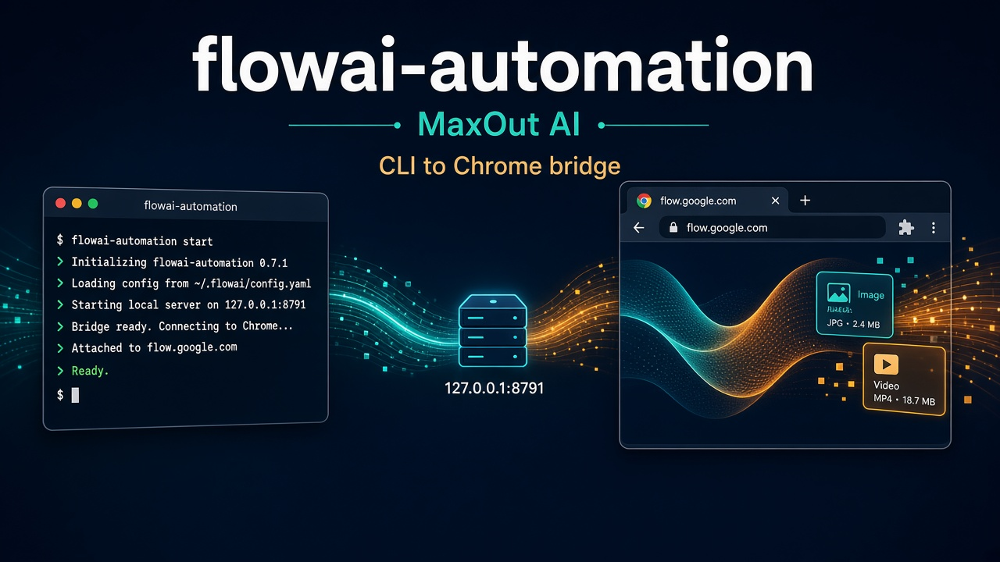
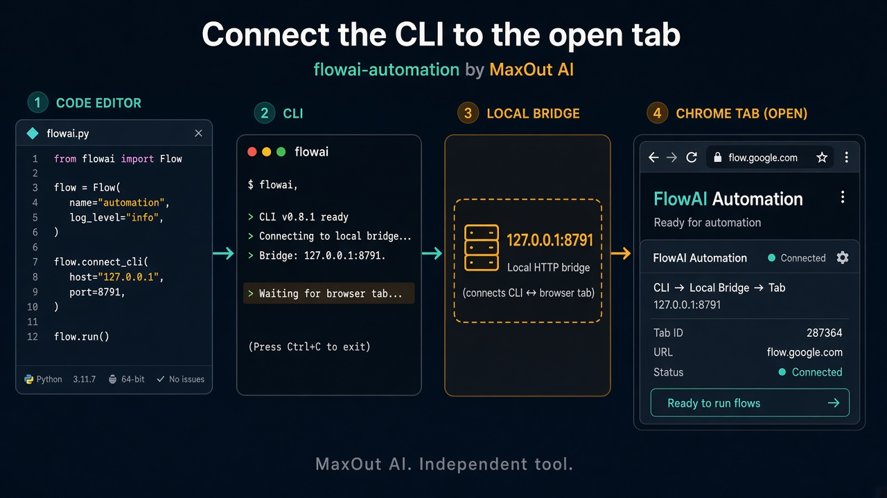
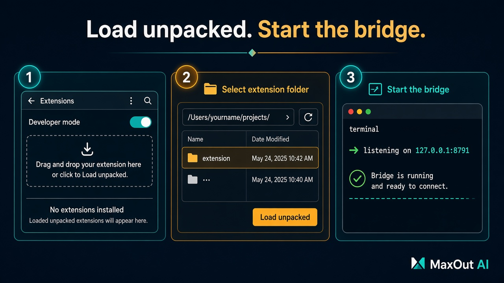
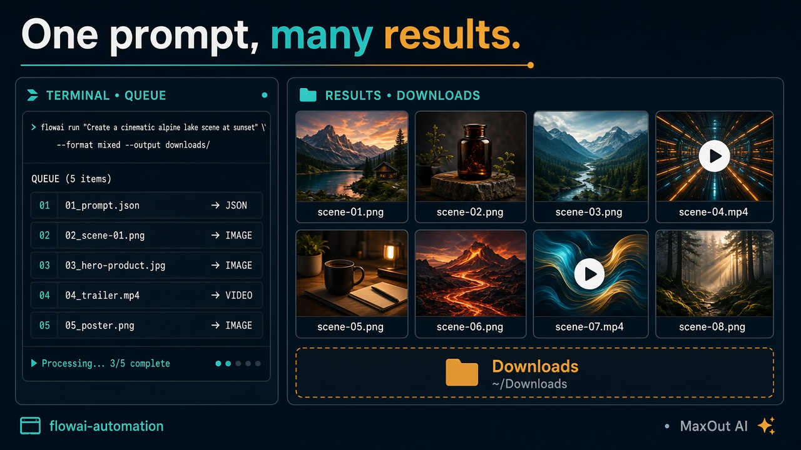
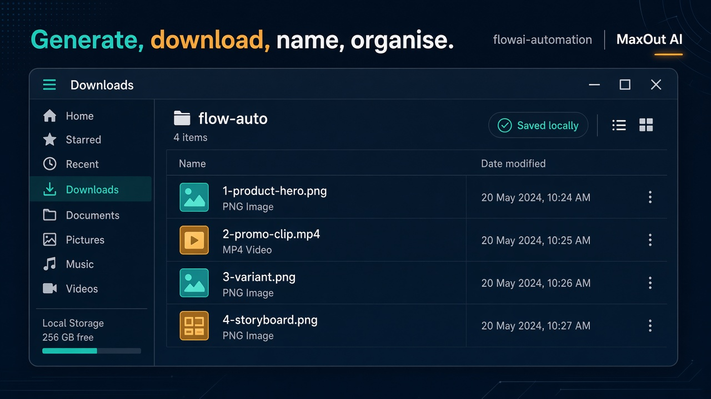

# flowai-automation

**Attribution: MaxOut AI**

Copyright (c) 2026 MaxOut AI

## License

Licensed under the MIT License by MaxOut AI. You may use, modify, and redistribute this code if you keep this copyright notice and the MIT license terms.

Full terms: [LICENSE](LICENSE).



## Our Chrome extension

> [!IMPORTANT]
> This is our Chrome extension. Download it, enable Developer mode in Chrome, and load it unpacked from the `extension/` folder.
>
> 1. Download this repo.
> 2. Open `chrome://extensions`.
> 3. Turn on Developer mode.
> 4. Click **Load unpacked** and choose the `extension/` folder.
> 5. Open <https://flow.google.com> and keep that tab visible.
> 6. Start the CLI so the bridge listens on `127.0.0.1:8791`.

flowai-automation (Flow Connector): the CLI talks to a local bridge, and the Chrome extension drives <https://flow.google.com>.





## CLI

```bash
npm install -g flow-connector-cli
flow-auto bridge start
flow-auto status --site flow
```

Needs Node.js 20+. `flow-auto` is the CLI. `bridge start` runs the local bridge in the foreground on `127.0.0.1:8791` (it also starts on first use). `status --site flow` checks the bridge, the extension, and the Flow tab. Queue prompts with `flow-auto`; finished files are saved to Downloads.





`bin/flow-movie` edits local clips and does not open Google Flow (`bin/flow-movie --help`).
