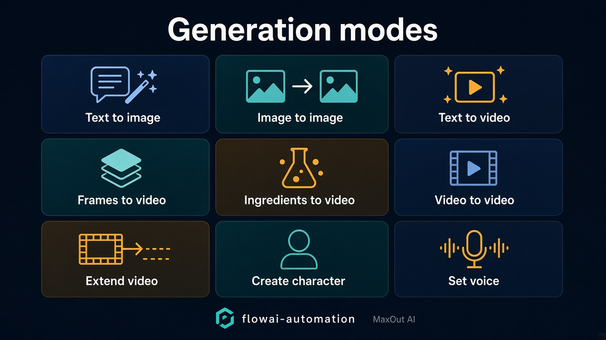

# flowai-automation


**Attribution: MaxOut AI**

**This copy and this skill cannot be replicated under the MIT license.**

## Our Chrome extension

> [!IMPORTANT]
> This is our Chrome extension. Download it, enable Developer mode in Chrome, and load it unpacked from the `extension/` directory.
>
> 1. Download this repo.
> 2. Open `chrome://extensions`.
> 3. Turn on Developer mode.
> 4. Click **Load unpacked** and choose the `extension/` folder.
> 5. Open <https://flow.google.com> and keep that tab visible.
> 6. Start the CLI so the bridge listens on `127.0.0.1:8791`.

**Connect your coding agent to [Google Flow](https://flow.google.com)**
Ask it to create images and videos the same way you ask it to write code.

This copy is attributed to MaxOut AI. Anyone in the coder community may change and
upgrade any part of the code, as long as this README still mentions MaxOut AI.
This copy and this skill cannot be replicated under the MIT license. Versions
1.0.0 to 1.0.9 were MIT; those releases stay under the licence they shipped with.

You can also use it on its own. Give it a list of prompts and it works through
them automatically, generating each result and saving the finished files to your
Downloads folder while you do something else.


## Why you'd install it

Creating images and videos one by one takes time and a lot of repetitive work.
Flow Connector automates that process: add your prompts once and it handles the
generation and the downloads.

It also gives your coding agent access to image and video generation, so your
agent can create visual assets when your project needs them.

- Let your coding agent generate visual assets when your project needs them
- Queue a list of prompts and let them run automatically
- Generate variations and assets in batches
- Images and videos download as soon as they're ready
- Files are saved with clear, readable names
- No API key is required — it works with your existing Google Flow account


## How the agent connection works

Open the extension, copy the setup prompt, and paste it into your coding agent
once. The extension sets up the connection automatically using a small local
helper — a skill for Claude Code, an MCP server for everything else.

After that you just say what you want:

```
> generate 20 product images and 5 promo videos, in different styles
```

The connection runs locally on your computer. Your prompts and files do not pass
through a server operated by us.


**A coding agent is how you drive it.** The side panel shows what is running,
and it is where you sign in and get the setup prompt — but prompts themselves
come from your agent or the `flow-auto` command, not from the panel.

### Which agents this works with

There are only two integrations, and the second one is a standard:

- **Claude Code** gets a native skill — `flow-auto skill install flow-generate`,
  which lands in `~/.claude/skills/` and every project sees it.
- **Everything else** registers `flow-auto-mcp`, a plain stdio MCP server. Most
  agents take it as:

  ```json
  { "mcpServers": { "flow-connector": { "command": "flow-auto-mcp" } } }
  ```

So the question is rarely *whether* an agent works — if it speaks MCP, it does —
but where its config file lives. The setup prompt figures that out by asking the
agent itself, which knows better than a dropdown would.

| Agent | Connects via | Config it usually writes |
|---|---|---|
| Claude Code | native skill | `~/.claude/skills/` |
| Cursor | MCP | `~/.cursor/mcp.json` |
| Codex | MCP | `~/.codex/config.toml`, or `codex mcp add` |
| Gemini CLI | MCP | `~/.gemini/settings.json`, or `gemini mcp add` |
| Windsurf | MCP | `~/.codeium/windsurf/mcp_config.json` |
| Anything else that speaks MCP | MCP | wherever that agent keeps user-level servers |

**Verified end to end on Claude Code.** The rest are ordinary MCP clients and
there is nothing unusual for them to trip over, but they have not each been sat
down and tested, and this page would rather say so than pretend. If one of them
misbehaves, open an issue — that is a bug worth fixing, not a limitation.

Use your **user-level** config, not a per-project one, so the connection follows
you between projects. The setup prompt asks for that explicitly.

## What you can make

Flow Connector supports Flow's available generation modes, including:



The available models depend on what Google Flow makes available to your account.

Joining finished clips, a music bed (its own volume, separate from the clips' sound), narration, burned-in captions plus an `.srt`, and continuing a shot from a clip's last frame are local commands. They were ported from [flow-mcp](https://github.com/GTAI-1/flow-mcp) under the ISC license declared in that project's `package.json`; the notice stays in [`vendor/flow-mcp-movie`](vendor/flow-mcp-movie). They do not drive the Flow tab. The next shot still goes through `flow-auto` and the extension, and only if you pass `--run`. The extension source is in [`extension/`](extension/).

## Film commands

Run them from this checkout as `bin/flow-movie`. That is the same command as the npm bin in `vendor/flow-mcp-movie`. Build that folder once with `npm install` and `npm run build` if the script says it is not built. `bin/flow-movie --help` lists every flag and its default. These commands do not open Google Flow.

`continue --run` is **off by default**. Without it, continue only writes a jpeg and prints the `flow-auto` line. Nothing is generated and no Flow credits are spent.

| Command | What you control |
|---|---|
| `voices` | No flags. Gemini and this computer's English voice names. Does not print a key. |
| `narrate` | `--text` (required), `--engine` (`gemini`, or `mac`), `--voice` (default `Charon` for Gemini; required for mac), `--style` (Gemini delivery, default none), `--model` (default `gemini-2.5-flash-preview-tts`), `--rate` (macOS say speed, default `168`), `--out` (default `./narration.m4a`). |
| `assemble` | `--dir` (required), `--clip` (repeatable), `--music` (path, looped, default none), `--music-volume` (default `0.25`), `--clip-volume` (clip audio, default `1`), `--voiceover` (path, default none), `--voice-volume` (default `1`), `--voice-lines` (timed JSON), `--output` (default `final` → `final.mp4`), `--hold-pad` (default `0.6` seconds), `--no-hold` (default: hold the last frame when the voiceover is longer). |
| `transcribe` | `<video>`, `--language` (default `auto`), `--no-words` (default: include word timings). |
| `captions` | `<video>`, `--style` (default `bold`), `--position` (default `bottom`), `--size` (default `medium`), `--language` (default `auto`), `--text`, `--letters`, `--name` (repeatable, for lowercase captions), `--color`, `--lead` (default `0.12`), `--out` (default `<stem>-captions.mp4`). Also writes a sibling `.srt`. |
| `continue` | `<video>`, `--prompt`, `--mode` (`exact` default, or `likeness`), `--asset` (character name, likeness only, repeatable), `--aspect-ratio`, `--model`, `--duration`, `--wait` (default off), `--wait-timeout`, `--frame` (default `<video>-lastframe.jpg`), `--run` (**default off**). |
| `caption-setup` | No flags. Says whether whisper and the speech models are present. |

```bash
bin/flow-movie assemble --dir ./film --clip a.mp4 --clip b.mp4 --music bed.mp3 --music-volume 0.25 --clip-volume 0.4 --voiceover narration.m4a --output final
bin/flow-movie captions scene.mp4 --style bold --language en --position bottom --size medium --out scene-captions.mp4
bin/flow-movie continue scene.mp4 --prompt "she looks back" --mode likeness --asset "NARRATOR"
```

`--mode exact` opens the next clip on that frame (`flow-frame-to-video`) and cannot take `--asset`. `--mode likeness` keeps the named character (`flow-ingredients-to-video`) and only approximates the opening frame. A Veo clip you already have open in Flow, and want made longer there, is still `flow-auto generate create flow-extend-video`. `continue` does not call it. Add `--run` on continue only when that generation should spend Flow credits.


## What generating costs

Flow Connector does not charge you per image or video.

Generation happens through your own Google Flow account and uses the credits and
limits provided by Google. The extension simply automates the workflow around
Flow.

## How it works

Flow Connector works with the real Flow interface in your browser, using the
Google account you are already signed into.

**One thing to know before you install:** the Flow tab itself has to stay open
and visible on screen while a run is in progress. Chrome
slows down windows that are minimised or covered, which would stall the
generation. The extension has a button that arranges the browser next to your
editor in one click.

Because it works through the actual Flow interface, Flow's own usage limits and
content rules still apply. The extension does not provide additional credits or
bypass those limits.

## This copy

**Attribution: MaxOut AI.** This copy runs with batching on (default 4). It does not split speed into a limited free tier and a paid Pro plan. Google Flow's own account limits still apply.

This copy and this skill cannot be replicated under the MIT license.

## Privacy

Your prompts and generated files stay between your browser and the services you
choose to use.

We do not use analytics, advertising, or tracking to monitor your activity. The
extension does not send your prompts or generated media to our servers.

This copy does not ask you to sign in to a paid plan. Full policy:
<https://flow-connector.flowconnector.workers.dev/privacy>

## Install

Download this repo and load the Chrome extension unpacked from [`extension/`](extension/). The steps are at the top of this page. This repo is the support channel and the home of the [agent skill](skills/flow-generate/SKILL.md) and the docs.

More detail is in [extension/EXTENSION.md](extension/EXTENSION.md).

## Something broken?

Open an issue.
Flow changes its interface fairly often and that is usually what breaks
automation, so the extension's Help tab fills most of the report in for you —
version, what the automation was doing, and where it stopped. Paste that in and
it is usually enough to find the problem.

## Press kit

The images on this page are in [`assets/`](assets/). The
extension's own mark:


## Not affiliated with Google

Flow Connector is an independent tool and is not affiliated with, endorsed by,
or sponsored by Google LLC.

Google product names are used only to describe compatibility. Automating a
website may be subject to that website's terms of service, so please use the
extension responsibly.
